<p align="center">
  
</p>

<h1 align="center">Corral</h1>

<p align="center">
  <strong>Lead intelligence that turns inbound interest into an explainable next action.</strong><br />
  Qualify, route, sync, and follow up from one human-controlled workspace.
</p>

<p align="center">
  <a href="#product-flow">Product flow</a> ·
  <a href="#local-setup">Run locally</a> ·
  <a href="#replit-deployment">Deploy to Replit</a> ·
  <a href="docs/architecture.md">Architecture</a>
</p>

<p align="center">
  
  
  
  
</p>

<details>
<summary><strong>Contents</strong></summary>

- [Product flow](#product-flow)
- [Release status](#release-status)
- [Recommended stack](#recommended-stack)
- [Explore the product](#explore-the-product)
- [Local setup](#local-setup)
- [Replit deployment](#replit-deployment)
- [API surface](#api-surface)
- [Configuration and secrets](#configuration-and-secrets)
- [Validation](#validation)
- [Architecture and phased plans](#architecture-and-phased-plans)

</details>

Production-ready foundation for a channel-agnostic lead qualification, explainable routing, CRM synchronization, and sales analytics demo. Corral turns inbound interest into an explainable next action for the right person, in the right channel, with a human in control.

> **Corral is a human-approved lead intelligence workspace.** It brings web, email, CRM, and social inquiries into one explainable pipeline, then helps teams route, review, and follow up without losing the decision history.

**Quick links:** [Product flow](#product-flow) · [Local setup](#local-setup) · [Replit deployment](#replit-deployment) · [API surface](#api-surface) · [Security](#configuration-and-secrets) · [Architecture](docs/architecture.md)

## Product flow

```mermaid
flowchart LR
    A[Web form / Gmail / CRM / Social] --> B[Normalize]
    B --> C[AI context]
    C --> D[ICP fit]
    D --> E[Qualify<br/>40 / 35 / 25]
    E --> F[Route by rules<br/>and workload]
    F --> G[Slack / CRM /<br/>human review]
    G --> H[Follow-up draft]
    H --> I[Human approves<br/>and sends]

    classDef input fill:#e7f5ef,stroke:#1e6b52,color:#0f2b20
    classDef ai fill:#e7efff,stroke:#2459a6,color:#10264b
    classDef action fill:#fff2df,stroke:#f2a541,color:#4a2b00
    class A input
    class B,C,D,E ai
    class F,G,H,I action
```



The dashboard mirrors this pipeline: inspect the lead, understand the evidence behind its score, adjust routing context when needed, and send a lead-specific follow-up only after a human approves it.

## Interactive demo walkthrough

Start the API and dashboard, seed the active development workspace, then use these links while the Vite server is running:

```powershell
uv run --project backend python -m lead_agent.seed --demo --workspace-id <your-workspace-id>
```

<table>
  <tr>
    <th>Try</th>
    <th>What to verify</th>
  </tr>
  <tr>
    <td><a href="http://localhost:5173/?view=dashboard&amp;range=monthly">Dashboard</a></td>
    <td>Qualification pulse, pipeline movement, channel performance, and revenue trend.</td>
  </tr>
  <tr>
    <td><a href="http://localhost:5173/?view=leads&amp;range=monthly&amp;lead_tab=overview">Leads</a></td>
    <td>Search, filter, select records, export, inspect a lead, and open its decision trail.</td>
  </tr>
  <tr>
    <td><a href="http://localhost:5173/?view=leads&amp;range=monthly&amp;lead_tab=ai">AI &amp; qualification</a></td>
    <td>Review score evidence and classification for every seeded lead.</td>
  </tr>
  <tr>
    <td><a href="http://localhost:5173/?view=pipeline&amp;range=monthly">Pipeline</a></td>
    <td>Compare received, qualified, routed, opportunity, and closed stages.</td>
  </tr>
  <tr>
    <td><a href="http://localhost:5173/?view=review&amp;range=monthly">Manual review</a></td>
    <td>Open the seeded low-confidence case and inspect the evidence that needs a human decision.</td>
  </tr>
</table>

<details>
  <summary><strong>Feature check list</strong></summary>

  - [ ] Change the dashboard range between Weekly, Monthly, and Annual.
  - [ ] Select leads from each Leads tab and confirm the bulk action bar stays aligned.
  - [ ] Open a lead and move through Overview, AI, Follow-ups, Comments &amp; closing, and History.
  - [ ] Adjust routing percentages and representative capacity in Settings.
  - [ ] Review integration cards before adding provider credentials.
  - [ ] Create a workflow draft and verify that sending still requires a human action.

</details>

## Release status

| Area | Status | Notes |
| --- | --- | --- |
| Core lead pipeline | Ready | Intake, normalization, context, ICP fit, qualification, routing, audit history |
| Dashboard | Ready | React/TypeScript product shell with dark/light visual system and explainable lead detail |
| Human-approved follow-up | Ready | Lead-specific drafts; sending remains an explicit human action |
| Integrations | Provider-ready | Workspace-scoped OAuth/credential boundaries and safe connection lifecycle |
| Production runtime | Deployment-ready with setup | Requires durable PostgreSQL, Redis, managed secret storage, public URLs, and provider credentials |
| Live-provider certification | Pending | Complete provider-console consent and controlled smoke checks before calling it production-certified |

The implemented scope includes durable multi-channel intake, deterministic/mock AI analysis, ICP qualification, configurable routing, notifications, provider-neutral CRM synchronization, workspace-scoped provider connections, controlled agent tools, analytics, production configuration validation, managed secrets, authentication/OAuth hardening, shared rate limiting, request correlation, redacted structured logs, and human-approved AI follow-up drafts. Automated follow-up sequences and browser E2E remain deferred.

The source build plan is preserved in [`doc/Lead Qualification & Routing Agent — Build Plan.docx`](<doc/Lead Qualification & Routing Agent — Build Plan.docx>). The normalized requirements are in [`docs/requirements.md`](docs/requirements.md), and the production architecture is in [`docs/architecture.md`](docs/architecture.md).

## Recommended stack

- Backend: Python 3.12, FastAPI, Pydantic v2, SQLAlchemy 2, Alembic, `uv`
- Async boundary: Celery with Redis; the current slice runs synchronously and keeps the queue boundary replaceable
- Database: PostgreSQL 16 with UUID identifiers and JSONB for raw/provider payloads and structured analysis
- Dashboard: React, TypeScript, and Vite
- AI boundary: `ReasoningProvider` with deterministic and OpenAI implementations; OpenAI is optional locally
- Notification boundary: `NotificationProvider` with deterministic/mock and Slack implementations
- CRM boundary: `CrmProvider` with deterministic/mock, Salesforce, and HubSpot implementations
- Connection boundary: workspace-owned `ProviderConnection` records containing secret references, never token values
- Agent boundary: permissioned, schema-validated tools with workspace/actor context, audit records, and idempotency

## Repository layout

```text
.
├── backend/src/lead_agent/
│   ├── api/              # FastAPI routes and typed responses
│   ├── application/      # pipeline, qualification, routing, and action use cases
│   ├── domain/           # canonical models, policies, ports, and configuration
│   ├── infrastructure/  # database, intake, reasoning, and notification adapters
│   ├── worker/           # future asynchronous task entry points
│   └── settings/         # typed runtime settings
├── backend/tests/        # unit and contract tests
├── frontend/src/         # React/TypeScript inspection experience
├── config/               # editable ICP, routing, and CRM mapping examples
├── docs/                 # requirements, architecture, and phased plan
├── infra/                # Docker Compose and Alembic migrations
├── scripts/              # seed and developer commands
├── .env.example
└── .gitignore
```

## Explore the product

| Area | What to inspect |
| --- | --- |
| Dashboard | Pipeline health, qualification distribution, routing activity, and recent runs |
| Leads | Explainable decision trail, source details, CRM history, and follow-up drafts |
| Integrations | Workspace-scoped Gmail, Outlook, Slack, Salesforce, and HubSpot connections |
| Settings | ICP versions, routing rules, email templates, workspace access, and deployment configuration |

The app is intentionally workspace-scoped: provider credentials, routing rules, templates, and audit history stay isolated per workspace. Secrets belong in the runtime secret manager or `.env`, never in Git.

## Why this architecture

Corral is a modular monolith for v1: one API, one worker boundary, one dashboard, and one database. Domain ports keep provider integrations replaceable while a single workspace-aware API keeps the first deployment understandable and easy to operate.

- **Explainable by default:** qualification scores, routing reasons, provider attempts, and pipeline history remain inspectable.
- **Human-controlled outreach:** the system can draft a follow-up, but a person reviews and sends it.
- **Workspace isolation:** credentials, ICP versions, routing rules, templates, and audit records are scoped to the active workspace.
- **Deployment-friendly:** the same repository supports local Docker development and a single-origin Replit Reserved VM deployment.

## Local setup

Prerequisites: Python 3.12+, Node.js 22+, Docker Desktop, and `uv`.

PowerShell from the repository root:

```powershell
Copy-Item .env.example .env
docker compose -f infra/compose/docker-compose.yml up -d
uv sync --project backend --extra dev
uv run --project backend alembic -c backend/alembic.ini upgrade head
uv run --project backend python -m lead_agent.seed
# Optional: populate the isolated Phase 6 demo workspace used by the product UI.
uv run --project backend python -m lead_agent.seed --demo
```

Run the API:

```powershell
uv run --project backend uvicorn lead_agent.api.main:app --reload --host 127.0.0.1 --port 8001
```

Run the dashboard in another terminal:

```powershell
Set-Location frontend
npm.cmd install
npm.cmd run dev
```

Open <http://localhost:5173>. API documentation is available at <http://localhost:8001/docs>.

## Replit deployment

### Short answer

**Yes. Importing this GitHub repository into Replit is the intended deployment path.** The repository already includes the root `.replit` configuration, a reproducible build script, a production start script, backend/frontend deployment files, and migrations.

The important caveat is that GitHub import only prepares the Repl. The production process deliberately refuses to start until its durable services and secrets are configured. That is a safety feature, not a broken build.

### What Replit runs automatically

This repository is structured for direct Replit import. Replit reads the root
`.replit` file, runs `bash scripts/replit_build.sh` once for the build, and
starts `bash scripts/replit_start.sh` for a Reserved VM web deployment.

1. `scripts/replit_build.sh` installs the backend package, runs `npm ci`, and builds the Vite dashboard.
2. `scripts/replit_start.sh` reads Replit’s `PORT`, binds the API to `0.0.0.0`, applies Alembic migrations, checks PostgreSQL and Redis, and serves the built dashboard and API from one origin.
3. The runtime supervises FastAPI/Uvicorn, one Celery worker, and one Celery beat scheduler.

### Replit publish checklist

1. Import `https://github.com/Harmain11/lead-qualification-routing-agent` into Replit.
2. Use **Reserved VM → Web server** for publishing. The background worker and beat scheduler must stay alive.
3. Provision durable PostgreSQL and managed Redis. SQLite and an ephemeral local Redis are not production storage.
4. Add the production secrets listed in [`docs/phase-7f-replit-production-deployment.md`](docs/phase-7f-replit-production-deployment.md). At minimum, configure the database, Redis, production security keys, managed secret backend, and OAuth credentials for the providers you will use.
5. Publish once to obtain the stable HTTPS origin.
6. Set `FRONTEND_PUBLIC_BASE_URL`, `INTEGRATION_PUBLIC_BASE_URL`, and `CORS_ALLOWED_ORIGINS` to that exact HTTPS origin.
7. Add the provider callback URLs from the deployment guide to Google, Slack, Salesforce, and HubSpot consoles.
8. Confirm `/health/live` returns `200`, then confirm `/health/ready` after PostgreSQL and Redis are reachable.
9. Run one controlled intake → qualification → routing → notification smoke test before inviting users.

The deployed app should use one origin such as `https://your-app.replit.app`. Do not upload `.env`, local SQLite databases, runtime logs, `frontend/.env.local`, npm caches, or Remotion renders as deployment configuration.

For the full secret list, encryption-key rotation guidance, database/Redis
requirements, callback patterns, health checks, and rollback procedure, use the
dedicated [Replit production deployment guide](docs/phase-7f-replit-production-deployment.md).

If `uv` is unavailable, use `python -m venv .venv`, activate it, install with `python -m pip install -e "backend[dev]"`, set `$env:PYTHONPATH = "$pwd\backend\src"`, and run the equivalent commands from that environment.

## API surface

- `POST /v1/leads` — create, normalize, analyze, qualify, route, and persist a manual lead.
- `POST /v1/intake/web` — validated website webhook with optional HMAC-SHA256 verification.
- `POST /v1/intake/email` — provider-neutral inbound email fixture/intake contract.
- `POST /v1/intake/linkedin` — official LinkedIn lead-form/export fixture contract; no scraping.
- `POST /v1/intake/fourth` — selected Clutch notification-email fixture contract.
- `GET /v1/leads` and `GET /v1/leads/{lead_id}` — inspect canonical leads and current decisions.
- `GET /v1/leads/{lead_id}/qualification` — inspect score components and rationale.
- `GET /v1/leads/{lead_id}/routing` — inspect the current route, assignment, action plan, and notification state.
- `GET /v1/leads/{lead_id}/routing/action-plan` — retrieve the sales-facing action plan.
- `GET /v1/leads/{lead_id}/routing/history` — inspect append-only routing history.
- `GET /v1/leads/{lead_id}/notifications` — inspect notification attempts.
- `GET /v1/leads/{lead_id}/pipeline-history` — inspect the ordered received-through-CRM lifecycle.
- `POST /v1/leads/{lead_id}/notifications/retry` — retry the current notification.
- `POST /v1/leads/{lead_id}/routing/reroute` — intentionally create a new route with a reason.
- `GET /v1/leads/{lead_id}/crm-sync` — inspect current CRM status and provider record IDs.
- `GET /v1/leads/{lead_id}/crm-sync/history` — inspect append-only synchronization history.
- `POST /v1/leads/{lead_id}/crm-sync` — perform an idempotent synchronization.
- `POST /v1/leads/{lead_id}/crm-sync/retry` — manually retry a retryable synchronization.
- `GET /v1/integrations` — list safe provider setup metadata and current-workspace connections.
- `POST /v1/integrations/{provider}/connect` and `/{provider}/callback` — OAuth lifecycle boundary.
- `POST /v1/integrations/{provider}/credentials` — store a manual credential through the secret port.
- `POST /v1/integrations/connections/{id}/test` — validate connection state safely.
- `POST /v1/integrations/connections/{id}/disconnect` or `/reconnect` — rotate connection state without returning secrets.
- `GET /v1/analytics/{dashboard|channels|pipeline|revenue|reps|time-series|agent-activity|manual-review}` — workspace-scoped weekly, monthly, or annual product analytics.
- `GET /health/live` and `GET /health/ready` — liveness/readiness checks.

## Configuration and secrets

Configuration is loaded from [`config/icp.example.yaml`](config/icp.example.yaml), [`config/routing.example.yaml`](config/routing.example.yaml), and [`config/crm.example.yaml`](config/crm.example.yaml). Routing policy and Salesforce/HubSpot field mappings remain editable configuration rather than scattered code.

The production default `LLM_PROVIDER=workspace` resolves a verified OpenAI key and allowlisted model from the lead's workspace, then falls back deterministically when no usable connection exists. Customer OpenAI keys use the same encrypted workspace secret store as other providers and are never environment variables or API response fields. `CRM_PROVIDER` remains a development fallback; a workspace-owned active Salesforce or HubSpot connection takes precedence. Development connection secrets use the process-local `SecretStore` implementation and disappear on restart. Production must bind the same port to the encrypted managed secret backend.

Production requests use opaque, server-side sessions in HttpOnly cookies. Every product request resolves the authenticated user, verifies an active workspace membership, and only then constructs `WorkspaceContext`; a browser-supplied workspace ID is a selection hint, never authority. Development headers remain available only when `APP_ENV` is development/test/local and `AUTH_DEVELOPMENT_FALLBACK=true`.

Every intake adapter emits the same durable source-event contract. Raw payloads and every decision remain inspectable through CRM delivery. Replaying the same lead reuses its route, notification, and CRM synchronization; changed canonical CRM payloads create a new historical sync attempt while preserving provider entity IDs.

## Validation

Backend checks run in the supported container with:

```powershell
docker exec lead-agent-api sh -lc "ruff check src tests && mypy src && pytest -q"
```

Frontend checks run with:

```powershell
docker exec lead-agent-frontend sh -lc "npm run typecheck && npm run build"
```

See [`docs/implementation-plan.md`](docs/implementation-plan.md), [`docs/architecture.md`](docs/architecture.md), and [`docs/integrations.md`](docs/integrations.md) for design boundaries and deferred integration work.

## Architecture and phased plans

| Document | Purpose |
| --- | --- |
| [`docs/architecture.md`](docs/architecture.md) | Runtime boundaries, provider ports, data ownership, and security model |
| [`docs/requirements.md`](docs/requirements.md) | Product requirements and acceptance criteria |
| [`docs/implementation-plan.md`](docs/implementation-plan.md) | Delivery phases and engineering work breakdown |
| [`docs/integrations.md`](docs/integrations.md) | Provider setup, directionality, scopes, and failure handling |
| [`docs/phase-7f-replit-production-deployment.md`](docs/phase-7f-replit-production-deployment.md) | Replit services, secrets, callbacks, smoke tests, and rollback |

The original build plan is preserved in [`doc/Lead Qualification & Routing Agent — Build Plan.docx`](<doc/Lead Qualification & Routing Agent — Build Plan.docx>).

## Phase 6 analytics and product experience

Analytics is aggregated on the server and every response includes generated-at, workspace, time-window, and demo/live provenance metadata. Revenue facts remain separate from qualification evidence and are labeled `crm`, `demo`, `mixed`, or `unavailable`; seeded revenue is never represented as production data.

After sign-in, the frontend derives the active workspace from the authenticated session. `VITE_WORKSPACE_ID` is used only by the explicit local development-session path, whose default is the reserved demo workspace (`00000000-0000-0000-0000-000000000006`). The demo seed command never inserts records into the default/live workspace.

The product shell provides Dashboard, Leads, Pipeline, Agents / AI Activity, Analytics, Integrations, Manual Review, and Settings. Its signature lead-intelligence network is one lazy-loaded React Three Fiber canvas backed by actual lead state. Mobile, reduced-motion, hidden-tab, and WebGL-unavailable paths use an accessible DOM/CSS topology.

## Phase 6.5 authentication and account linking

- `POST /v1/auth/signup`, `/signin`, `/signout`, and `/development-session` manage opaque sessions; `GET /v1/auth/session` returns safe identity and membership metadata.
- `POST /v1/auth/workspace` changes the current workspace only after membership verification.
- Cookie-authenticated mutations require CSRF validation. Passwords use salted `scrypt`; session and CSRF token digests, not raw tokens, are persisted.
- Migration `0010_production_authentication` adds users, memberships, and revocable/expiring sessions.
- `OAUTH_BROKER=provider` enables operator-owned OAuth applications. Customers only click Connect, sign in, and approve scopes.
- OAuth state expires after ten minutes, is single-use, and is bound to a PKCE verifier stored through `SecretStore`. Provider tokens never enter frontend code or connection API responses.
- `OAUTH_BROKER=development` remains a deterministic local callback loop for tests.

## Phase 7A1 production configuration and security

- `APP_ENV` is explicitly `development`, `test`, or `production`. Production startup rejects development authentication, insecure cookies, wildcard/non-HTTPS CORS, deterministic/mock providers, demo mode, local secret storage, development OAuth, placeholder security secrets, and implicit local persistence endpoints.
- `DevelopmentSecretStore` remains process-local for tests and standalone local runs. The Replit preview selects the encrypted database-backed secret store with `SECRET_STORE_PROVIDER=managed`, `MANAGED_SECRET_STORE_BACKEND=lead_agent.infrastructure.encrypted_secrets:create_backend`, and a dedicated `SECRET_STORE_ENCRYPTION_KEY`; production uses its configured deployment-owned backend. Only opaque references and safe status metadata are persisted.
- Session cookies have bounded expiry, configurable SameSite behavior, Secure/HttpOnly production enforcement, authentication-time rotation, revocation, and CSRF protection. Passwords use uniquely salted `scrypt` at the current OWASP-equivalent minimum, and revoked memberships cannot restore or access their workspace.
- OAuth state is high entropy, hashed, expiring, single-use, atomically claimed, and bound to workspace, provider, callback, and actor. PKCE uses S256 and its verifier is replaced by provider credentials after exchange.
- Provider disconnect deactivates the local connection before remote revocation. Failed or unsupported remote revocation is recorded as safe metadata and cannot leave the connection usable.
- The frontend uses optional public `VITE_API_BASE_URL`; server credentials must never use the `VITE_*` namespace. Seed commands are disabled in production, and demo records remain isolated to the reserved demo workspace.

## Phase 7A2 operations and deployment readiness

- API rate limits use shared Redis in production and a deterministic in-memory adapter for development/tests. Named policy groups and limits are configured through environment variables.
- Request IDs are validated/generated for every request and returned in `X-Request-ID`. Production logs use JSON and shared structured redaction; security headers include anti-framing policy and HSTS in production.
- Readiness checks PostgreSQL and required Redis without exposing connection information or depending on optional providers. Database pool/TLS and Redis timeout/retry settings are explicit.
- `uv run --project backend production-check` validates production settings without printing secret values. See [`docs/production-deployment.md`](docs/production-deployment.md) for topology and deployment checklist.
- Celery has bounded reliability defaults, but application flows remain synchronous and no task or outbox dispatcher is currently registered. Durable CRM and notification state is committed before provider calls.
