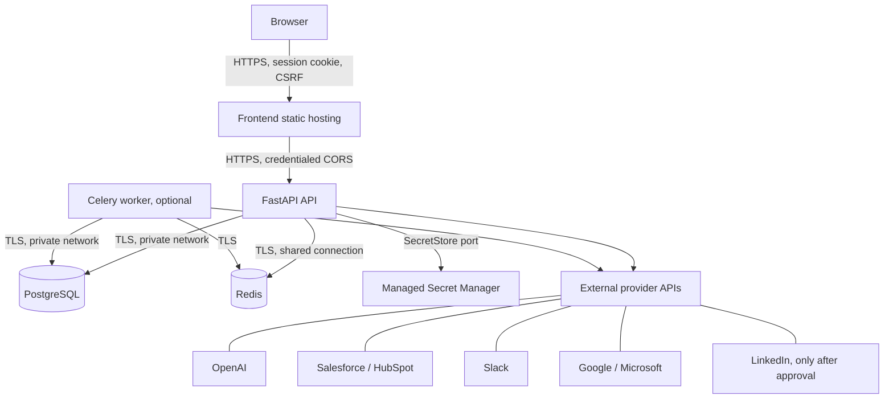

# Production deployment topology and checklist

This document describes the application boundary without assuming a cloud vendor. Provisioning and deployment are outside this repository's Phase 7A2 scope.

## Topology

The current API performs intake, qualification, CRM synchronization, and notifications synchronously. Celery and Redis configuration are ready for bounded asynchronous jobs, but no application task or outbox dispatcher is registered. No scheduler is currently required.

Lead creation records `lead.qualified` in `outbox_messages` in the same transaction as the lead, but that event is not dispatched yet. CRM synchronization commits its pending/syncing row before network I/O. Routing commits its decision and notification attempt before Slack delivery. These existing synchronous paths retain durable state and bounded/manual retries without claiming automated outbox delivery.

## Network and browser boundaries

- Give the frontend and API explicit HTTPS domains. Terminate TLS at a trusted edge, redirect HTTP to HTTPS, and forward the original client address only through trusted proxy configuration. Do not trust arbitrary `X-Forwarded-For` input.
- Set `FRONTEND_PUBLIC_BASE_URL` and `INTEGRATION_PUBLIC_BASE_URL` to public HTTPS base URLs. Configure CORS with the exact frontend origin(s), never `*` with credentials.
- Prefer frontend and API hostnames under the same site so `SameSite=Lax` session cookies work naturally. For cross-site deployments, use `SameSite=None; Secure`, retain CSRF checks, and confirm browser third-party-cookie behavior before launch.
- Register each OAuth redirect URI exactly as `https://<api-domain>/v1/integrations/<provider>/oauth/callback`. OAuth app client credentials belong in the deployment secret system; the browser receives only the provider authorization URL and state.
- The API emits `X-Request-ID`, `X-Content-Type-Options`, `X-Frame-Options`, `Referrer-Policy`, `Permissions-Policy`, a non-embedding CSP, and HSTS in production. These API response headers do not set the frontend document policy.
- Configure CSP at the frontend host. A starting policy should restrict scripts to same-origin bundles, allow the configured API in `connect-src`, allow same-origin/data/blob image assets, allow the app's inline style attributes, and permit `blob:` workers if used. Keep `frame-ancestors 'none'`, `object-src 'none'`, and `base-uri 'self'`. Do not restrict top-level OAuth navigation with an incomplete provider allowlist. Review against actual asset origins before enforcing.

## Service connectivity and health

- PostgreSQL is the durable source of truth. Use a private network, a non-placeholder application identity, TLS (`DATABASE_SSL_MODE=require` or stronger verification), bounded connection pools, and a migration job before serving traffic.
- Redis is shared by API instances for rate limits and is the configured Celery broker/backend when workers are enabled. Use a private endpoint and `rediss://` in production, restrict network access, and set capacity/eviction policy so rate-limit keys cannot evict queue data unexpectedly. Separate Redis instances or databases are recommended when operational policies differ.
- The API and optional worker need PostgreSQL, Redis, and managed-secret connectivity. Workers use the same application configuration and provider secret boundary as the API.
- `/health/live` confirms that the process is responsive and does not call dependencies. `/health/ready` checks PostgreSQL and required Redis and returns only safe component states. Optional external providers do not affect readiness.
- Liveness/readiness probes should use the API domain internally or a private service address and must not require user authentication.

## Startup and configuration

Set `APP_ENV=production`, `LOG_FORMAT=json`, `AUTH_DEVELOPMENT_FALLBACK=false`, secure session cookies, explicit HTTPS origins, a production PostgreSQL URL with SSL, a `rediss://` Redis URL, `RATE_LIMIT_BACKEND=redis`, and the deployment-owned managed-secret adapter. Retain explicit production-safe provider selections from Phase 7A1. Configure only the selected CRM fallback and required notification/LLM providers; credentials for unselected providers are not needed.

Before deployment, run `uv run --project backend production-check`. It validates configuration and never prints values. It does not connect to infrastructure; readiness checks dependency connectivity after startup. Run Alembic migrations as a separately controlled release step. The managed secret backend must be resolvable by the API and any worker before requests are accepted.

## Workspace Communication media

Workspace Communication attachments and voice messages use a **private Vercel Blob** store. Connect a
private store to the Vercel project before enabling uploads. The runtime must receive either the
connected store's `BLOB_READ_WRITE_TOKEN`, or Vercel OIDC credentials (`BLOB_STORE_ID` and
`VERCEL_OIDC_TOKEN`). Do not expose either value through `VITE_*` variables. Media is always fetched
through the authenticated API route, which rechecks workspace and conversation membership before
streaming it to a browser.

Vercel Functions cap request bodies at 4.5 MB, so `COMMUNICATION_ATTACHMENT_MAX_BYTES` defaults to
4 MiB. Larger media needs a direct-to-Blob client-upload endpoint. Vercel Cron calls the authenticated
`/v1/internal/cron` endpoint every five minutes; set a random 32+ character `CRON_SECRET` so due CRM
syncs and communication reminders run without a persistent worker or Beat process.

For cloud-neutral staging or provider certification, set
`MANAGED_SECRET_STORE_BACKEND=lead_agent.infrastructure.encrypted_secrets:create_backend`, inject
a base64url-encoded 32-byte `SECRET_STORE_ENCRYPTION_KEY`, and set a non-empty
`SECRET_STORE_KEY_VERSION`. Keep the key outside PostgreSQL. During rotation, provide old
version-to-key mappings through `SECRET_STORE_PREVIOUS_KEYS` until all secret records have been
rewritten under the active version. A deployment may instead supply an AWS, Azure, GCP, or Vault
adapter implementing the same scoped lifecycle.

## Deployment checklist

- [ ] DNS records point frontend and API domains to the intended HTTPS edges.
- [ ] TLS certificates are valid; HTTP redirects to HTTPS; the edge forwards only trusted proxy metadata.
- [ ] Frontend build sets public `VITE_API_BASE_URL` to the API HTTPS origin; no server credential uses a `VITE_*` variable.
- [ ] API environment has exact CORS origins, frontend/API base URLs, secure cookie settings, and registered OAuth callback URLs.

## Public authentication and Google login

The public auth surface supports email/password and Google OpenID Connect only. Register the
following production callback in the Google OAuth client:

`https://<production-origin>/v1/auth/google/callback`

The Google login request is intentionally limited to `openid email profile`. It creates or finds a
local user by the stable Google `sub`, provisions one private owner workspace for a genuinely new
user, and then issues the same opaque CRM session used by password login. Google tokens are never
used as CRM sessions and are never stored in the workspace provider-connection tables.

Gmail remains a separate workspace integration with its own callback:

`https://<production-origin>/v1/integrations/gmail/oauth/callback`

Only that Gmail connection requests `https://www.googleapis.com/auth/gmail.readonly`. The two flows
have separate database state, PKCE verifiers, rate limits, and callback paths.

Password signup records submitted email addresses as unverified. Before production launch, enable
`AUTH_REQUIRE_EMAIL_VERIFICATION=true` together with the operator's transactional verification-mail
delivery and verification endpoint implementation; Google signup may rely on Google's verified email
claim. The default development/test setting remains false so local test accounts are usable.
- [ ] PostgreSQL is reachable over private networking with TLS, bounded pools, and production credentials from the deployment system.
- [ ] Apply Alembic migrations and verify the migration head before enabling traffic.
- [ ] Redis is shared, private, TLS-enabled, sized for rate-limit and queue workloads, and configured with connection timeout/retry settings.
- [ ] Managed secret backend and operator-owned OAuth app credentials resolve in API/worker runtime identities.
- [ ] `production-check` passes in CI/CD without printing secrets.
- [ ] `/health/live` and `/health/ready` are wired to distinct orchestrator probes; readiness is observed after migrations.
- [ ] Start the Celery worker and Beat scheduler for CRM inbound synchronization and Workspace
      Communication reminders; verify both schedules against the configured Redis broker.
- [ ] Structured logs are shipped with request/operation identifiers, redaction, retention limits, and alerts for provider failures, retry exhaustion, and readiness failures.
- [ ] Verify backups, point-in-time recovery, restore procedure, migration recovery plan, and retention/deletion policy before production data is accepted.
- [ ] Run a credential-pattern scan on artifacts and deployment configuration; keep live provider certification as a separate approved operation.
